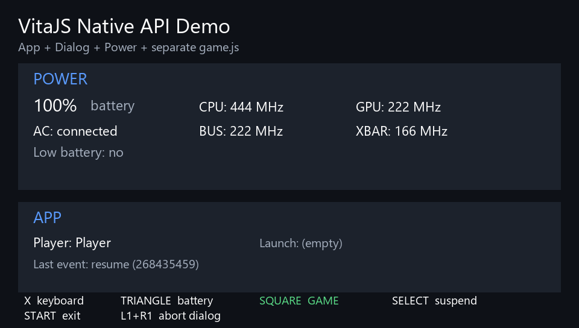
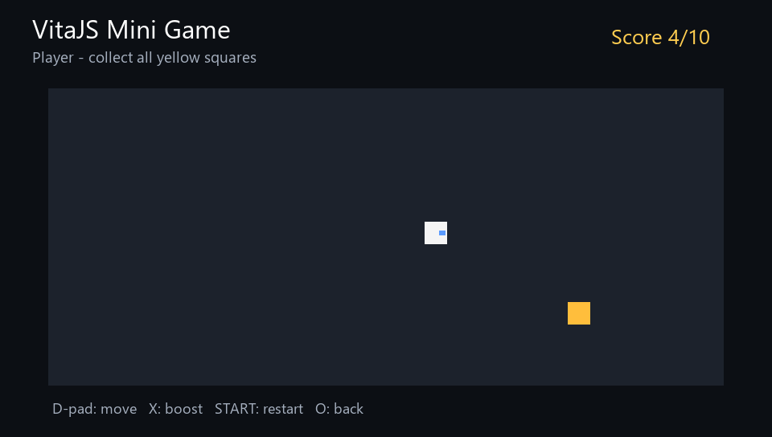

Please, prefer to use AlphaSystemsPL's repo: https://github.com/AlphaSystemsPL/PSVitaJS

Thank you for your support!

---

# vitajs

> VitaJS was originally created by faelpinho and is now actively developed and extended by AlphaSystemsPL.

VitaJS is an experimental JavaScript runtime for building games and applications for the PlayStation Vita.

It embeds **QuickJS 2026-06-04** and exposes native PS Vita / vita2d functionality to JavaScript through global modules. The goal is to keep low-level Vita integration in C while writing most game and application logic in JavaScript.

> **Status:** work in progress. APIs may change. Always validate hardware-facing functionality on a real PS Vita — Vita3K can behave differently from physical hardware.

## Screenshots

| Native API demo | Mini-game example |
| --- | --- |
|  |  |

## ⚡ Major QuickJS performance upgrade

VitaJS has moved from **QuickJS 2021-03-27** to the **QuickJS 2026-06-04 core**.

The QuickJS author reports that the 2026-06-04 release is **42% faster than the previous 2025-09-13 release** in the `bench-v8` benchmark. The 2026 release alone includes a new small-block allocator and multiple interpreter micro-optimizations.

Because VitaJS previously used the much older **2021-03-27** engine, the total performance difference versus the old VitaJS runtime is expected to be larger than that 42% figure. There is no official cumulative 2021→2026 benchmark, so an exact number cannot be claimed; as a rough engineering estimate, **~50–70% faster on JS-heavy workloads is plausible**, depending heavily on the code being executed.

In practical VitaJS testing, the upgrade produced a clearly visible improvement: a test game that previously experienced frame-rate drops now holds **60 FPS consistently**.

> The 42% figure is an official QuickJS `bench-v8` result for 2026-06-04 vs 2025-09-13. The 50–70% figure is an estimate for the much larger 2021→2026 gap, not an official QuickJS benchmark and not a guaranteed FPS increase.

Source: [QuickJS official website](https://bellard.org/quickjs/) and [QuickJS changelog](https://bellard.org/quickjs/Changelog).

---

## Features

Current VitaJS functionality includes:

- JavaScript execution through QuickJS 2026-06-04
- ES modules
- 2D rendering with vita2d
- PNG, JPG and BMP textures
- PS Vita controls, analog sticks and multi-controller ports
- front and rear touch input
- TTF/OTF font rendering
- WAV sound effects with a native audio mixer
- streamed PCM WAV and OGG/Vorbis audio for music and longer tracks
- synchronous HTTP requests
- filesystem access through `System`, `std` and `os`
- application metadata, system language and Vita / Vita TV model information
- QuickJS timers
- native PS Vita message dialogs and IME keyboard
- application lifecycle helpers
- battery, clocks and power-management helpers
- VS Code IntelliSense through `vitajs.d.ts`
- centralized native module registry

### Available global modules

| Module | Purpose |
| --- | --- |
| `Screen` | Rendering, textures and drawing |
| `Pads` | Buttons, analog sticks and controller ports |
| `Touch` | Front/rear touch input, panel info and sampling |
| `Font` | TTF/OTF font loading and text rendering |
| `Audio` | WAV SFX, mixing and WAV/OGG streaming |
| `Net` | Promise-based HTTP/HTTPS fetch and direct-to-disk download |
| `System` | Filesystem, app metadata, language and hardware model helpers |
| `App` | Process exit, launch params, system events and info bar |
| `Dialog` | Native message dialogs and IME keyboard |
| `Power` | Battery, clocks, suspend, standby and display power |
| `std` | QuickJS standard library |
| `os` | QuickJS timers, filesystem and OS helpers |

---

## Runtime architecture

```text
JavaScript game / app
        │
        ▼
     QuickJS
        │
        ├── Screen ──► vita2d / SceGxm
        ├── Pads   ──► SceCtrl
        ├── Touch  ──► SceTouch
        ├── Font   ──► vita2d / FreeType
        ├── Audio  ──► SceAudioOut / Tremor
        ├── Net    ──► SceHttp / SceNet / SceSsl
        ├── System ──► filesystem / SFO / system params
        ├── App    ──► SceAppMgr / process manager
        ├── Dialog ──► SceCommonDialog / SceIme
        └── Power  ──► ScePower
```

The JavaScript entry point is:

```text
app0:/assets/main.js
```

VitaJS supports ES modules, so application code can be split normally:

```js
import { Game } from "./game.js";
```

Remember to package imported files into the VPK.

---

## Documentation

API examples are kept in separate files under [`docs/`](docs/README.md).

| Guide | Description |
| --- | --- |
| [Quick start](docs/quick-start.md) | Minimal VitaJS application structure |
| [Screen](docs/screen.md) | Rendering, textures and primitives |
| [Pads](docs/pads.md) | Buttons, analog sticks and controller ports |
| [Touch](docs/touch.md) | Front/rear touch input and panel control |
| [Font](docs/font.md) | Loading fonts, drawing and measuring text |
| [Audio](docs/audio.md) | WAV SFX plus WAV/OGG streamed audio |
| [Net](docs/net.md) | Promise-based HTTP/HTTPS fetch and downloads |
| [System](docs/system.md) | Filesystem, manifest, language and hardware info |
| [App](docs/app.md) | Lifecycle, events and process helpers |
| [Dialog](docs/dialog.md) | Native message boxes and IME keyboard |
| [Power](docs/power.md) | Battery, clocks and power management |
| [Timers](docs/timers.md) | `os.setInterval`, game loop and cleanup |

The most complete API signature reference is [`src/assets/vitajs.d.ts`](src/assets/vitajs.d.ts).

---

## Using a prebuilt VPK

If you only want to change the JavaScript application or its assets, you do not need to install VitaSDK or compile the entire project. A VPK is a ZIP-compatible archive, so you can use an existing VitaJS VPK as a ready-made runtime:

1. Download or copy a prebuilt `vitajs.vpk`.
2. Open or extract it with a ZIP-compatible archive tool.
3. Replace `assets/main.js` and add any imported JavaScript modules, images, fonts or audio files under `assets/`.
4. Repack the archive with its original directory structure and keep the `.vpk` extension. Files such as `eboot.bin`, `sce_sys/` and `assets/` must remain at the archive root, not inside an additional parent directory.
5. Transfer the modified VPK to the console and install it with VitaShell.

Compile the project only when you need to change the native C runtime, add native modules or update linked libraries. Every file imported or loaded by your application must still be included in the repacked VPK.

---

## Requirements

You need a working VitaSDK installation.

Set the `VITASDK` environment variable and add its binaries to `PATH`:

```bash
export VITASDK=/path/to/vitasdk
export PATH="$VITASDK/bin:$PATH"
```

Install the libraries used by VitaJS:

```bash
vdpm install libvita2d bzip2
```

OGG/Vorbis streaming additionally requires **libogg** and **libtremor** from VDPM. With the current VDPM CLI these packages can be installed from the VDPM directory with:

```bash
./vdpm libogg libtremor
```

The build also uses VitaSDK system libraries for graphics, controls, touch, dialogs, power, audio, networking and SSL. `vorbisidec` must be linked before `ogg` because Tremor depends on libogg.

---

## Building

Clone the repository:

```bash
git clone https://github.com/AlphaSystemsPL/PSVitaJS.git
cd PSVitaJS
```

Configure and build:

```bash
cmake -S . -B build
cmake --build build -j 8
```

For a completely clean rebuild:

```bash
rm -rf build
cmake -S . -B build
cmake --build build -j 8
```

The resulting package is:

```text
build/vitajs.vpk
```

Install the VPK on a PS Vita or run it in Vita3K.

---

## Assets and ES modules

Runtime files must be included in `vita_create_vpk()`.

Example:

```cmake
vita_create_vpk(${PROJECT_NAME}.vpk ${VITA_TITLEID} ${PROJECT_NAME}.self
    VERSION ${VITA_VERSION}
    NAME ${VITA_APP_NAME}

    FILE
        src/assets/main.js assets/main.js
        src/assets/game.js assets/game.js
        src/assets/test1.png assets/test1.png
        src/assets/segoeui.ttf assets/segoeui.ttf
        src/assets/audio.wav assets/audio.wav
        src/assets/music.ogg assets/music.ogg

        sce_sys/icon0.png sce_sys/icon0.png
        sce_sys/livearea/contents/bg.png sce_sys/livearea/contents/bg.png
        sce_sys/livearea/contents/startup.png sce_sys/livearea/contents/startup.png
        sce_sys/livearea/contents/template.xml sce_sys/livearea/contents/template.xml
)
```

If `main.js` contains:

```js
import { Game } from "./game.js";
```

then `game.js` must also exist inside the VPK as:

```text
app0:/assets/game.js
```

`vitajs.d.ts` is an editor declaration file. The runtime does not require it, even if the sample project chooses to package it.

---

## VS Code IntelliSense

VitaJS includes `src/assets/vitajs.d.ts` with declarations for the runtime globals.

A typical `jsconfig.json`:

```json
{
    "compilerOptions": {
        "target": "ES2020",
        "allowJs": true,
        "checkJs": false,
        "lib": [
            "ES2020"
        ]
    },
    "include": [
        "src/assets/vitajs.d.ts",
        "src/**/*.js"
    ],
    "exclude": [
        "build"
    ]
}
```

Do not add the browser `DOM` library unless you intentionally need it. DOM typings define globals such as `Screen` and `Audio`, which conflict with VitaJS globals.

If IntelliSense does not refresh:

```text
Cmd/Ctrl + Shift + P
→ TypeScript: Restart TS Server
```

---

## Native module architecture

Native modules live in:

```text
src/modules/
```

C sources are collected automatically by CMake. The native module registry is:

```text
src/modules/modules.def
```

The same registry is used to declare module initializers, register modules in each QuickJS context and expose them on `globalThis`.

Adding a new native module normally requires:

1. add `src/modules/example.c`
2. add one entry to `src/modules/modules.def`
3. add/update declarations in `src/assets/vitajs.d.ts`
4. add linker stubs in `CMakeLists.txt` only when the module requires a new Vita library

Example registry entry:

```c
VITAJS_MODULE(Example, vitajs_example_init)
```


---

## QuickJS

VitaJS currently uses the **QuickJS 2026-06-04 core**.

The project keeps Vita-specific integration around QuickJS where the VitaSDK environment differs from desktop POSIX. QuickJS sources are compiled with the upstream-compatible `-fwrapv` assumption and optimized separately.

When upgrading QuickJS again, treat generated/version-coupled files such as regexp and Unicode tables as a single release set.

---

## Current limitations

VitaJS is still under active development.

Notable limitations include:

- `Net.fetch()` / `Net.download()` return Promises, but the current native SceHttp transfer still runs on the QuickJS/main thread and can block the render/game loop while I/O is in progress
- VitaJS is not a browser runtime: there is no DOM and no global browser `fetch()`; use `Net.fetch()` instead
- there is no Node.js API
- several legacy/experimental VitaJS APIs are incomplete
- hardware-facing APIs can behave differently or be unavailable in Vita3K

For native module development, test on real hardware whenever possible.

---

## Roadmap ideas

Potential future improvements include:

- truly non-blocking network I/O while preserving the current Promise API
- motion sensors
- save-data helpers
- remote JavaScript/content loading
- application/content updater
- more complete texture and graphics APIs
- improved error reporting and diagnostics
- additional hardware-specific input and system integrations

---

## Credits

VitaJS builds on the work of the PS Vita homebrew ecosystem.

Special thanks to:

- the original VitaJS author and contributors
- VitaSDK contributors
- vita2d contributors
- QuickJS
- AthenaEnv Team
- DanielSant0s

---

## Disclaimer

VitaJS is an unofficial homebrew project and is not affiliated with or endorsed by Sony Interactive Entertainment.
